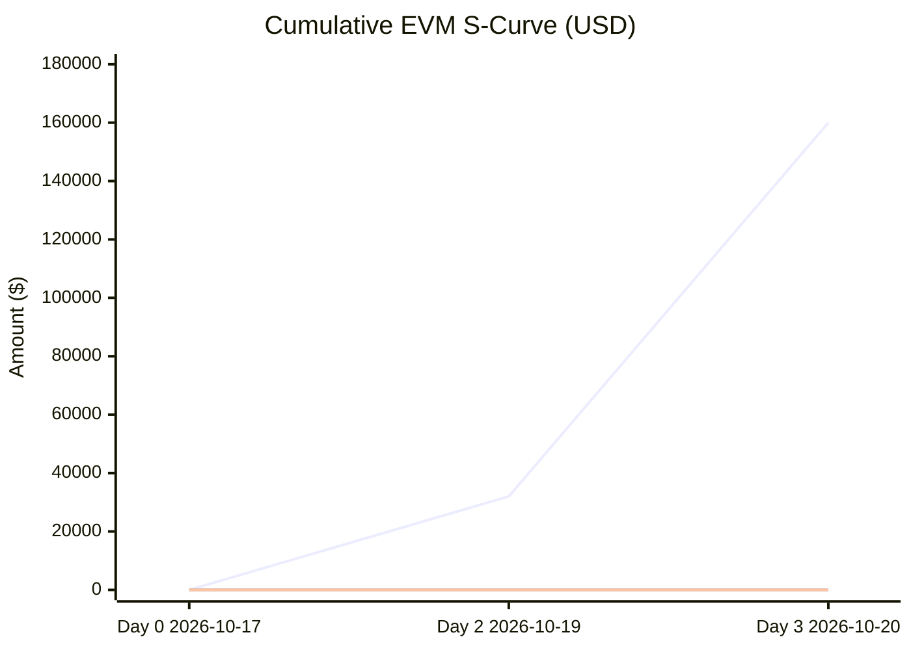

# Project Dashboard: Warehouse Inventory & Storage Management REST API (WMS Core)

## Document Control
- **Document Title:** Project Dashboard
- **Project Name:** Warehouse Inventory & Storage Management REST API (WMS Core)
- **Current Version:** 1.1
- **Status Date:** 2026-10-20
- **Date:** 2026-10-20

## Changelog
| Version | Date | Change Description |
|---|---|---|
| 1.0 | 2026-10-17 | Initial baseline performance measurement dashboard |
| 1.1 | 2026-10-20 | New measurement at status date 2026-10-20 (previous status date 2026-10-17). Baselines unchanged (Business Case 1.0, WBS 1.1, Backlog 1.1, Schedule Model 1.1, Change Log 1.1; no approved change requests). No actuals reported: AC = 0 and physical percent complete = 0 for all Milestone 1 work packages. PV recomputed as the time-phased planned value at 2026-10-20, which is the full Milestone 1 schedule (project duration 10 days, all work packages finished by early finish day 10). EV = 0, CV = 0, SV = -160000, indexes CPI and SPI null or 0 as defined by the formulas. Forecast reset: EAC = BAC because CPI is undefined (no actuals); ETC = BAC; VAC = 0; TCPI = 1.0. S-curve extended to the schedule horizon. |

## 1. Executive RAG Status
| Dimension | Status | Metric / Justification |
|---|---|---|
| **Overall** | Red | SPI is 0.0 (EV = $0.00 vs PV = $160,000.00) with work overdue against the baseline schedule. Schedule Red drives the overall rating. No actuals reported (AC = $0.00). |
| **Scope** | Green | 100% of WBS elements and requirements defined in baseline scope (BAC = $160,000.00 for Milestone 1). Milestones 2-4 are not costed (see Assumptions). |
| **Schedule** | Red | SPI is 0.0 (Work overdue against baseline schedule; EV = $0.00 vs PV = $160,000.00). SV = -$160,000.00. |
| **Cost** | Green | CPI is undefined (null, AC = $0.00); no actual cost has been reported. EAC = $160,000.00 (default BAC), VAC = $0.00. Rated Green on the absence of recorded overrun only; not a measured cost performance result. |
| **Quality** | Green | Quality gates established; automated test coverage target set at $\ge 80\%$. No test coverage measurements reported. |
| **Risk** | Amber | Moderate-to-high residual risk exposure. Highest scores: RSK-01 (Score 20, Critical) and RSK-02 (Score 16, Critical). No issues have materialized. |

## 2. EVM Performance Metrics
| Metric | Value | Interpretation |
|---|---|---|
| **BAC** | $160,000.00 | Budget at Completion (Milestone 1 work packages only) |
| **PV** | $160,000.00 | Planned Value as of 2026-10-20 (full Milestone 1 schedule) |
| **EV** | $0.00 | Earned Value (no physical progress reported; 0% complete on all work packages) |
| **AC** | $0.00 | Actual Cost (no actuals reported) |
| **CV** | $0.00 | Cost Variance ($EV - AC$) |
| **SV** | -$160,000.00 | Schedule Variance ($EV - PV$) |
| **CPI** | null | Cost Performance Index ($EV / AC$); undefined because AC = 0 |
| **SPI** | 0.0 | Schedule Performance Index ($EV / PV$) |
| **EAC** | $160,000.00 | Estimate at Completion (default method BAC / CPI; CPI undefined, so EAC set to BAC) |
| **ETC** | $160,000.00 | Estimate to Complete ($EAC - AC$) |
| **VAC** | $0.00 | Variance at Completion ($BAC - EAC$) |
| **TCPI** | 1.0 | To-Complete Performance Index ($(BAC - EV) / (BAC - AC)$) |

### 2.1 Work Package EVM Detail
| WBS | Work Package | BAC ($) | % Complete | PV ($) | EV ($) | AC ($) |
|---|---|---|---|---|---|---|
| 1.1.1 | Core PostgreSQL Schema Design | 24,000.00 | 0% | 24,000.00 | 0.00 | 0.00 |
| 1.1.2 | Migration Scripts & Rollback Mechanisms | 16,000.00 | 0% | 16,000.00 | 0.00 | 0.00 |
| 1.2.1 | JWT/OAuth2 RBAC Token Validation | 24,000.00 | 0% | 24,000.00 | 0.00 | 0.00 |
| 1.2.2 | Role-Based Permission Enforcement Decorators | 16,000.00 | 0% | 16,000.00 | 0.00 | 0.00 |
| 1.3.1 | RFC 7807 problem+json Exception Handlers | 16,000.00 | 0% | 16,000.00 | 0.00 | 0.00 |
| 1.3.2 | OpenAPI Documentation Skeleton Setup | 16,000.00 | 0% | 16,000.00 | 0.00 | 0.00 |
| 1.4.1 | Dockerfile & Containerization Setup | 16,000.00 | 0% | 16,000.00 | 0.00 | 0.00 |
| 1.4.2 | Automated CI Pipeline with Test Coverage Gates | 32,000.00 | 0% | 32,000.00 | 0.00 | 0.00 |
| | **Total** | **160,000.00** | **0%** | **160,000.00** | **0.00** | **0.00** |

## 3. Earned Value S-Curve
Cumulative PV, EV, and AC by period (USD). Cumulative EV and AC are 0 through the status date.

| Period | Date | Cumulative PV | Cumulative EV | Cumulative AC |
|---|---|---|---|---|
| Day 0 (Project start) | 2026-10-17 | 0.00 | 0.00 | 0.00 |
| Day 2 | 2026-10-19 | 32,000.00 | 0.00 | 0.00 |
| Day 3 | 2026-10-20 | 160,000.00 | 0.00 | 0.00 |

*(Series order: Cumulative PV, Cumulative EV, Cumulative AC.)*

## 4. Critical Milestones
| Milestone | Baseline Date | Forecast Date | Status |
|---|---|---|---|
| Milestone 1: Core Architecture & Foundation Setup | 2026-10-27 | 2026-10-27 (not re-forecast; no actuals reported) | Pending Execution (0% complete; critical path 1.1.1 → 1.1.2 → 1.4.1 → 1.4.2 at zero float) |

## 5. Variance Commentary & Corrective Actions
- **Schedule Variance (SV = -$160,000.00, SPI = 0.0):** No physical progress or actual cost has been reported against any Milestone 1 work package as of 2026-10-20. EV is therefore zero while PV reflects the full planned Milestone 1 schedule. The SPI of 0.0 is a reporting-gap signal, not yet a measured performance result.
- **Cost Variance (CV = $0.00, CPI null):** No actual cost is recorded, so CPI cannot be computed. VAC = $0.00 is a default result of EAC = BAC and carries no performance information.
- **Methodology caveat (PV):** The 2026-10-17 measurement showed PV = $160,000.00, which implies all work was planned complete on day 0. This is inconsistent with the 10-day schedule model and is flagged for correction. PV is kept at $160,000.00 for consistency with the approved prior measurement.
- **Corrective Actions:**
  1. Obtain physical percent-complete and actual cost (timesheet/effort) for all eight Milestone 1 work packages before the next measurement; re-run EVM at that point.
  2. Initiate or confirm execution of WBS 1.1.1 (Core PostgreSQL Schema Design) and WBS 1.2.1 (JWT/OAuth2 RBAC Token Validation), the two zero-float starting activities.
  3. Protect the zero-float critical path (1.1.1 → 1.1.2 → 1.4.1 → 1.4.2) with a daily critical-path check; apply the 3-day schedule contingency reserve only with Sponsor approval (RSK-11).
  4. Correct the PV baseline methodology (day-based schedule vs. cumulative PV) and re-baseline the time-phased PV in the next EVM revision.

## 6. Top Risks, Open Changes & Decisions Needed
- **Top Risks:**
  - *RSK-01 (Concurrency Race Conditions, Score: 20, Critical):* Requires optimistic locking (ETag/version headers) and atomic multi-resource transactions. Owner: Backend Developer.
  - *RSK-02 (Query Performance Degradation, Score: 16, Critical):* Requires optimized indexing in WBS 1.1.1 and stress testing in Milestone 4. Owner: Database Architect.
  - *RSK-09 (Unquantified Business Case / Funding Baseline, Score: 12, High):* No headcount, currency budget, or quantified benefit baseline; blocks ROI verification. Owner: Project Manager.
  - *RSK-11 (Milestone 1 Critical Path Slip, Score: 12, High):* Zero float on four activities. Owner: Project Manager.
- **Open Changes / RFCs:** None. Change Log 1.1 records no change proposed and no threshold breached (critical path delay 0.0 days; cost delta 0.0%).
- **Decisions Needed:**
  1. Executive Sponsor: confirm authorization to commence Milestone 1 execution and approve the baseline risk mitigation strategies.
  2. Executive Sponsor and Project Manager: name the Project Manager and confirm the actuals reporting cadence so EV and AC can be measured at the next status date.
  3. Executive Sponsor: approve the methodology correction for PV (time-phased baseline) and direct the quantified Business Case baseline (RSK-09) to be established in Milestone 1.

## 7. Assumptions & Limitations
- BAC of $160,000.00 is the sum of the eight Milestone 1 work package budgets from EVM Metrics 1.0. Work package budgets are allocated pro rata to effort hours at an assumed uniform rate of 1,000 USD per effort hour; the source does not state this rate explicitly.
- Milestones 2-4 are adaptive and held in the Product Backlog with story points only. They carry no BAC here, so this measurement is not the full project cost and BAC must be re-baselined once the backlog is costed.
- The schedule start is assumed to be 2026-10-17. The status date 2026-10-20 falls at day 3 of the schedule model; the full Milestone 1 PV is retained at $160,000.00 for consistency with the approved 1.0 measurement and flagged for correction.
- Currency (USD) is carried from EVM Metrics 1.0. Business Case 1.0 states no currency budget.
- The S-curve planned value between days 0 and 2 is shown only at the two source-derived points; the intermediate distribution is not given in the source and is not estimated here.
- Cost RAG is Green only because no overrun is recorded; it is not a measured performance result. Quality RAG reflects the target and gates set, not measured coverage.
- Risk Register 1.1 items RSK-08 to RSK-12 are monitor-only and are not reflected in the EVM numbers.
- Thresholds applied: CPI and SPI Green ≥ 0.95, Amber 0.90–0.95, Red < 0.90 (or null with work overdue). SPI = 0.0 with work overdue is Red; CPI is null, so the Cost RAG is not computed from an index.
